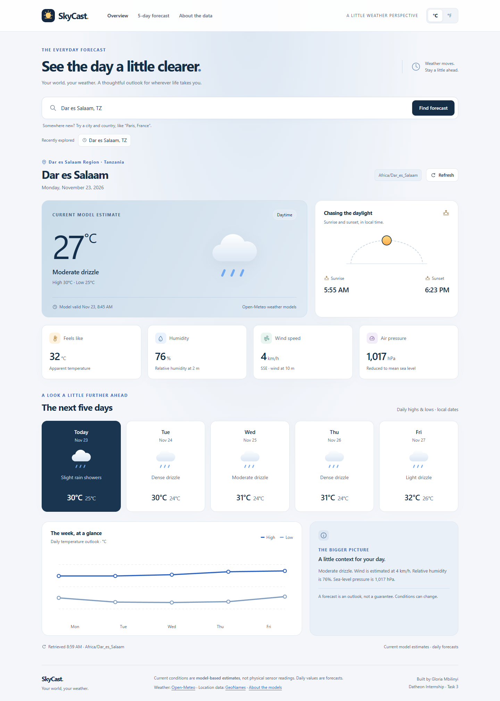
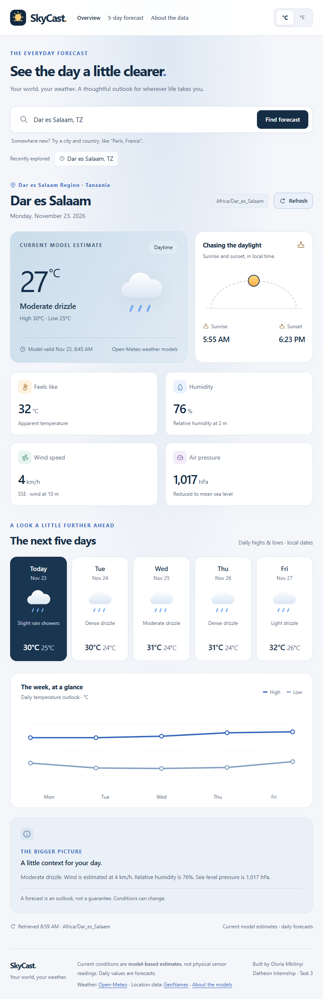
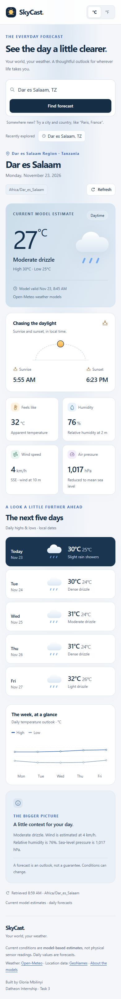

# SkyCast — Weather & Climate Dashboard

**Your world, your weather.**

A responsive weather dashboard built with semantic HTML, modern CSS, and vanilla JavaScript ES modules. Find a city anywhere in the world, choose the matching region, and explore current weather estimates alongside a five-day forecast.

**Datheon Full Stack Web Development Internship · Task 3 — Real-Time Weather Forecast & Climate Telemetry App**

[Repository](https://github.com/gloria-mbilinyi/skycast-datheon) · [Developer](https://github.com/gloria-mbilinyi)



## The problem

A city name alone is not always enough to find the right weather. SkyCast makes location choice explicit, keeps the forecast readable on small screens, and explains the difference between current model estimates, future forecasts, missing fields, and a saved response that may be stale.

## Features

- Worldwide city lookup with multiple matching locations, regions, countries, and explicit selection.
- Debounced suggestions after three characters; explicit searches support two or more characters.
- Current temperature, feels-like temperature, relative humidity, wind speed/direction, sea-level pressure, condition labels, and day/night status.
- Five daily forecast cards, including today when supplied by the API, with maximum/minimum temperatures and condition icons.
- Local sunrise/sunset, a temperature trend chart, a data-derived conditions summary, model-valid time, and retrieval time.
- Documented WMO code mapping, including unknown-code fallbacks and day/night icons.
- Clear, cloud, rain, snow, and night gradients with readable text and reduced-motion support.
- Celsius/Fahrenheit switching for current, apparent, high/low, and chart temperatures without an extra API call.
- Loading indicators and skeletons, unknown-city states, missing-field labels, friendly network/API errors, and retry controls that respect rate limits.
- Recent cities and unit preferences in localStorage, with graceful storage-denial/corruption handling.
- Last-successful-response cache, limited to 24 hours and explicitly labeled **“Saved forecast — not current.”** A failed request only reuses a cache for the same city coordinates.
- Keyboard-operated suggestions, focus indicators, screen-reader announcements, responsive layouts, and safe DOM text rendering.

There are no sample weather values in the application. The initial screen invites a search. Test fixtures are isolated under `tests/` and never enter the deployed application bundle.

## API integration

SkyCast calls the documented public [Open-Meteo Geocoding API](https://open-meteo.com/en/docs/geocoding-api) and [Forecast API](https://open-meteo.com/en/docs). It uses `fetch`, `async`/`await`, `try`/`catch`, `URLSearchParams`, linked abort signals, and a 12-second request timeout. Newer requests cancel older ones and use a generation guard before updating the UI.

Geocoding returns up to eight choices. Forecast requests use selected coordinates, `timezone=auto`, Unix timestamps, Celsius, km/h, and `forecast_days=5`. Current and daily fields are validated before rendering. Unit switching converts the retained Celsius source data locally.

Dates use the API’s returned daily boundaries and UTC offset; sunrise, sunset, and timestamps use its IANA timezone through `Intl.DateTimeFormat`. Invalid/missing timezones are explicitly shown as a UTC fallback. Missing values stay **Unavailable**, including missing chart points.

**Current conditions are weather-model estimates, not physical sensor readings. Daily data are forecasts.** The app does not perform historical climate analysis. Attribution links to Open-Meteo and GeoNames remain visible in the footer.

## Technologies and architecture

HTML5 · CSS3 custom properties, Flexbox and Grid · Vanilla JavaScript ES6+ modules · Fetch/AbortController · localStorage · Node.js test runner · Playwright · axe-core.

There are no runtime dependencies, private API keys, backend services, databases, external fonts, or paid services. npm dependencies are for development/testing only.

```text
skycast-datheon/
├── index.html
├── css/
│   ├── variables.css         # Tokens, shared controls, focus/motion rules
│   ├── style.css             # Dashboard components
│   ├── responsive.css        # Tablet and mobile adaptations
│   └── weather-themes.css    # Condition-dependent gradients
├── js/
│   ├── app.js                # State, request coordination, UI events
│   ├── api.js                # Transport, timeouts, cancellation, API URLs
│   ├── search.js             # Input/location validation, keyboard combobox
│   ├── weather.js            # Current response normalization and WMO mapping
│   ├── forecast.js           # Daily normalization and chart coordinates
│   ├── ui.js                 # Safe DOM rendering and status/retry controls
│   ├── storage.js            # Recent cities, units, and stale-response cache
│   └── utils.js              # Units, numbers, dates, and timezone helpers
├── assets/
│   ├── icons/skycast.svg
│   └── screenshots/          # Actual API-backed application captures
├── scripts/                  # Preview, source checks, live API evidence
├── tests/
│   ├── *.test.js             # Deterministic unit tests
│   ├── fixtures/weather.js   # Mock data, never deployed
│   └── browser/              # Mocked end-to-end and accessibility tests
├── playwright.config.js
├── package.json
├── package-lock.json
└── README.md
```

## Install and run locally

Node.js **22 or newer** is needed for the included local tooling.

```sh
git clone https://github.com/gloria-mbilinyi/skycast-datheon.git
cd skycast-datheon
npm start
```

Open **http://127.0.0.1:4273/**. No npm install is needed just to serve the application. Use an HTTP/HTTPS server rather than double-clicking the HTML file, because the app uses JavaScript modules. Internet access is needed for fresh weather requests.

Any static host can serve `index.html`, `css/`, `js/`, and the icon assets. The included Node server is local preview tooling and is not an application backend. Set `$env:PORT = '8080'` before `npm start` in PowerShell to choose another preview port.

## Using SkyCast

1. Enter a city or a city/country combination, such as `Paris, France`.
2. Select the intended city and region. SkyCast never silently chooses among identical names.
3. Read current estimates and the five-day outlook. **Refresh** requests new data.
4. Use °C/°F to switch all temperature views; wind stays in km/h and pressure in hPa.
5. Reopen a recent city to request its forecast again. On reload, a saved response is clearly stale until refreshed.

Keyboard: `/` focuses search. Up/Down explore matching locations; Enter selects the active match; Home/End move within an active list; Escape dismisses it. Tab continues normal page navigation. The user’s browser geolocation is never requested or stored.

## Saved data and privacy

Keys are namespaced as `skycast.recents.v1`, `skycast.preferences.v1`, and `skycast.cache.v1`, each with a versioned JSON format. At most five selected city centers are retained; no precise device location is collected. The cache holds one successful API response and its retrieval time.

Storage errors do not stop live search. Unsupported or corrupt saved data are preserved rather than automatically overwritten; a persistent notice explains the issue. Saved data belong to the current browser profile and exact origin, so localhost and the deployed website have separate storage. Browser settings can clear site data when desired.

## Screenshots and live evidence

Screenshots were taken from the actual app using real API responses, not fixtures. Weather changes over time; these are captures from **23 November 2026**. `assets/screenshots/live-evidence.json` records the source URL, API statuses, timezone, model-valid time, temperature comparison, browser version, and tested widths.

| Tablet · 768px | Mobile · 390px |
| --- | --- |
|  |  |

With the preview running, `npm ci` then `npm run screenshots` regenerates the captures in a fresh browser context, without touching your usual browser’s saved cities.

## Testing and verified results

Verified locally on **23 November 2026** with Node.js 24 and Chrome 157:

| Check | Result |
| --- | --- |
| JavaScript syntax and local asset references | Passed |
| Deterministic unit tests | **34 passed, 0 failed** |
| Mocked Playwright integration tests | **23 passed, 0 failed** |
| Widths | **1440px, 768px, 390px, 320px** |
| Themes | Clear, cloud, rain, snow, night at every width |
| Accessibility | No axe WCAG 2.1 A/AA violations in tested welcome, results, and themed dashboard states |
| Missing/long data | Missing measurements and long location names fit the tested narrow layout |
| Separate live API browser check | Both APIs returned HTTP 200; five forecast days; displayed temperature matched the API; no recorded runtime errors |

```sh
npm ci
npm run check
npm test
npm run test:browser
# All deterministic checks:
npm run test:all
# Separate real API check (requires preview and internet):
npm run test:live
```

Windows uses installed Chrome by default. Set `PLAYWRIGHT_CHANNEL=msedge` to use Edge. On Linux/macOS install the matching browser with `npx playwright install chromium`. Reports, screenshots, and failure traces are generated in Git-ignored `playwright-report/` and `test-results/`.

Regression tests mock Open-Meteo deterministically. They cover validation, geocoding, unknown/multiple cities, current/daily normalization, WMO mapping, conversion, timezone/DST dates, missing fields, network/API failures, rate limiting, cancellation, both search/forecast races, persistence/cache behavior, safe text rendering, keyboard controls, overflow, and accessibility. Live connectivity is checked separately and does not make CI dependent on provider availability.

To run against the deployment in PowerShell:

```powershell
$env:SKYCAST_BASE_URL = 'https://gloria-mbilinyi.github.io/skycast-datheon/'
npm run test:browser
npm run test:live
```

## Deployment

Target: free **GitHub Pages**, using a GitHub Actions workflow that verifies deterministic checks before publishing. The production milestone adds the static release build and enables HTTPS. Success is reported only after the workflow, served revision, and real API-backed production behavior are verified.

Relative asset/module paths support the repository subdirectory `/skycast-datheon/`. The app can also be served as a static Cloudflare Pages project without backend infrastructure.

## Known limitations

- Fresh data depend on internet access, browser CORS support, and Open-Meteo availability and public-service limits.
- Weather values are model estimates/forecasts and can change; they are not station measurements or historical climate statistics.
- The five-day request includes today. If the provider supplies fewer records, the app shows the available days without fabricating the rest.
- Cached data expire after 24 hours and always remain labeled stale; the cache does not make the app shell installable/offline. There is no service worker, background update, push notification, or geolocation feature.
- Recent cities, unit preference, and cached data are browser-local and are lost if site data are cleared. No cross-device account or sync exists.
- Dates follow the provider’s daily aggregation boundaries; actual event clocks use its timezone. Missing solar events, such as unavailable polar sunrise/sunset, remain unavailable.
- Modern ES modules, Fetch, AbortController, and Intl timezone support are expected. Firefox, Safari, physical devices, and a full screen-reader audit were not separately tested.

## Developer

**Gloria Beneth Mbilinyi**

Dar es Salaam Institute of Technology (**DIT**)

Datheon Full Stack Web Development Internship

- GitHub: [gloria-mbilinyi](https://github.com/gloria-mbilinyi)
- LinkedIn: [Gloria Mbilinyi](https://www.linkedin.com/in/gloria-mbilinyi/)
- Project: [skycast-datheon](https://github.com/gloria-mbilinyi/skycast-datheon)
